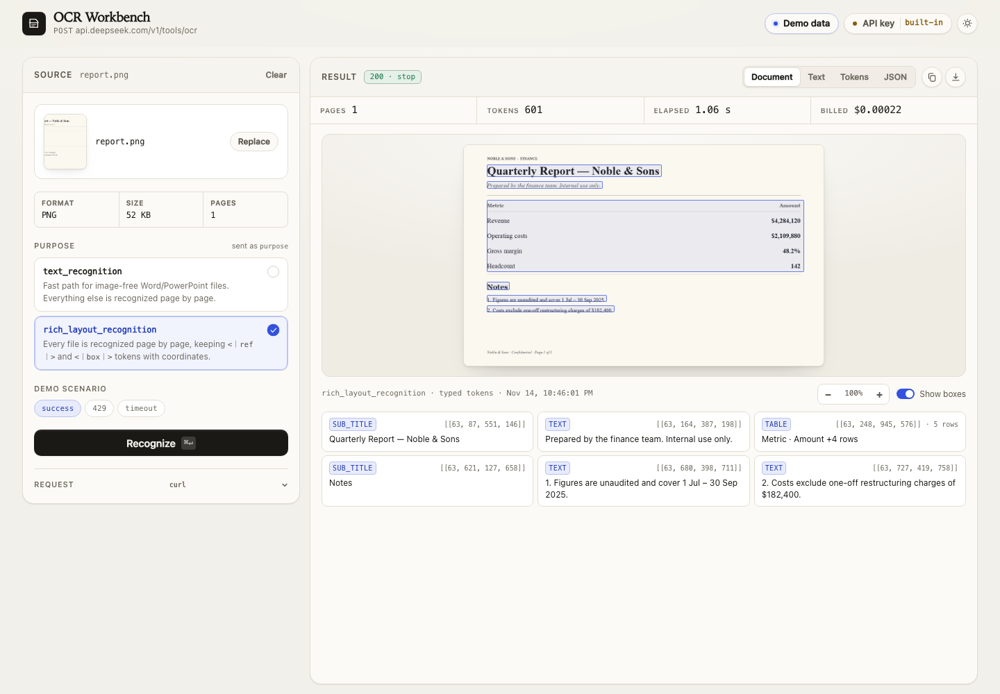

# OCR Workbench

A browser test bench for the [DeepSeek OCR API](https://api-docs.deepseek.com/guides/ocr).
Drop a document, pick a purpose, and read the result page by page — with the
`｜ref｜`/`｜box｜` coordinates drawn back onto the page.

No build step, no dependencies, no server code. Static files, deployable to any
static host.



## Run it

```bash
python3 -m http.server 4180
open http://127.0.0.1:4180/index.html
```

Serve over `http://localhost` — opening `index.html` as a `file://` URL blocks the
request with a CORS error.

## Bring your own key

No key ships with this page. Click **API key** in the header and paste one from
[platform.deepseek.com](https://platform.deepseek.com/api_keys); it is stored in
this browser's `localStorage` and sent only to `api.deepseek.com`.

**No key at all?** Flip **Demo** in the header. Every scenario then replays a real
captured response from `demo/recorded/` — success for all three formats, a `429`,
a `200`-body gateway timeout, and the intermittent empty page.

## What it does

**Source panel.** Drag a file in, or load one of the samples. Accepts PDF, Word,
PowerPoint and images, exactly like the API. Images and PDFs get a real
thumbnail (PDF via pdf.js, first page). Size, format and page count are read
locally before anything is sent.

**Purpose.** The two documented values, with the consequence of each spelled out.
The API's behaviour is not symmetric, and the UI says so:

| purpose | what comes back |
| --- | --- |
| `text_recognition` | Markdown. Word/PowerPoint files without images are *text-extracted*, not recognized. **No tokens.** |
| `rich_layout_recognition` | Every file recognized page by page, keeping `｜ref｜`/`｜box｜` tokens with coordinates. |

**Result panel.** Four views of the same response:

- **Document** — the page with every `<box>` drawn in place, plus a block list.
  Hover or focus a block to highlight its region and see its coordinates. Tables
  preview as their header row plus a row count, never as raw `<table>` markup —
  the unmodified service output lives in the Tokens and JSON tabs.
- **Text** — the recognized content, rendered as Markdown. Built from DOM nodes,
  never `innerHTML` of API text.
- **Tokens** — the raw page text with the special tokens highlighted.
- **JSON** — the whole response body, downloadable.

**Opening a block.** The card clamps to two lines; clicking opens the whole block
in a near-fullscreen dialog with the extracted text or parsed table on the left
and the source page on the right, so the result and the pixels can be compared
side by side. The page pane zooms 50 %–400 %, a **Box** switch draws the opened
block's coordinates on it, and a button next to the Rendered/Raw tabs switches the
left pane to the OCR of the whole document. See [readme.html](readme.html) for the
full tour.

**Errors.** Every documented failure is mapped to a cause and a next step: `400`
bad form, `401` key rejected, `402` no balance, `408` slow upload, `413` too
large, `429` 15 concurrent jobs, `500`, `503`, `504`, and the `200`-with-`error`-body
gateway timeout.

## Things the live API does that the guide does not say

Found by testing against the real endpoint; the UI handles all of them.

1. **The rich-layout token shape is different from the guide.** The docs put the
   text inside the ref; the live service puts the element **type** in the ref and
   the content **after** the box. `js/parse.js` detects both shapes.

   ```
   <｜ref｜>sub_title<｜/ref｜><｜box｜>[[63,87,551,146]]<｜/box｜> # Quarterly Report
   ```

2. **`text_recognition` returns no tokens at all** — Markdown instead, and HTML
   tables for tabular content. "No boxes" is a normal result, not a failure.

3. **Dense tables can come back malformed.** On `samples/bank-statement.pdf`,
   `rich_layout_recognition` emits nested `<table><table>` with each header cell
   duplicated (`<td>CODE</td><td>CODE</td>`). The parser collapses the duplication
   and the workbench recommends `text_recognition` for that page.

4. **Responses can arrive with `status 200` and an `error` body**, because
   recognition starts before it can fail. The body is always checked for `error`.

5. **A page can come back empty with `200 OK`.** Roughly one request in three
   returned a blank page during testing. The status chip turns amber
   (`200 · empty`) and the toast offers *Run again* — the retry normally succeeds.

6. **High-detail pages vary run to run.** Two identical requests can return
   different numbers of tokens.

Recorded responses for every claim above are in `demo/recorded/`.

## Files

```
index.html          structure
styles.css          design system
readme.html         standalone "how it works" page, linked from the header
js/parse.js         token parser (both token shapes)
js/render-md.js     safe Markdown renderer for the plain-text output
js/app.js           state machine, requests, rendering
assets/             icon, favicon, social preview
samples/            test documents
demo/recorded/      real captured API responses, used by Demo mode
tools/              headless-Chrome verification, social card source
```

## Verifying the UI

```bash
node tools/verify-ui.js
```

Checks box-overlay accuracy against real ink, layout integrity from 1152 px to
2560 px, the type scale, motion rules, hover gating, focus rings, tap targets and
keyboard paths.
